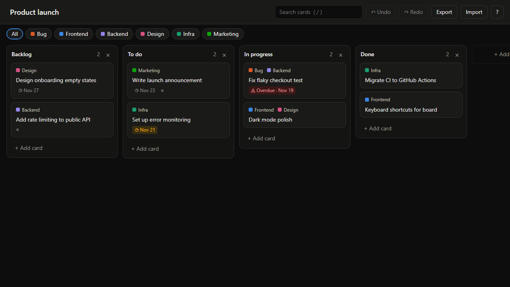

# Flowboard

[](https://github.com/timmichael738/flowboard/actions/workflows/ci.yml)


**A fast, keyboard-friendly Kanban board.** Drag and drop cards and columns, undo anything,
filter instantly, and keep everything offline in your browser. No account needed.

### 👉 [Live demo](https://timmichael738.github.io/flowboard/)



## Features

- **Drag and drop** cards within and across columns, and reorder the columns themselves
  ([dnd-kit](https://dndkit.com/)), with a lifted drag preview.
- **Works without a mouse.** Tab to a card, press <kbd>Space</kbd> to pick it up, use the arrow
  keys to move it and <kbd>Space</kbd> to drop it. Screen readers get dnd-kit's live announcements.
- **Undo/redo everything.** <kbd>Ctrl</kbd>/<kbd>⌘</kbd>+<kbd>Z</kbd> and
  <kbd>Ctrl</kbd>/<kbd>⌘</kbd>+<kbd>Shift</kbd>+<kbd>Z</kbd> work for moves, edits, deletes and
  even imports. History is capped at 100 steps.
- **Shortcuts**: <kbd>N</kbd> new card, <kbd>/</kbd> search, <kbd>?</kbd> help. They're disabled
  while you're typing in a field or a dialog is open.
- **Search and label filters** that apply instantly. Drag and drop pauses while a filter is active,
  so you can't drop a card into a position you can't see.
- **Rich cards**: description, labels and due dates. Overdue and due-soon cards are flagged with an icon and
  text, not color alone.
- **Offline-first.** The board autosaves to `localStorage` (debounced). JSON **export/import** is
  validated, including referential integrity, before it touches your data.
- **Light and dark mode** that follows your OS. Label colors come from a colorblind-safe palette.

## Architecture

The board is a single immutable state tree driven by a **pure reducer**. Undo/redo is a
generic higher-order reducer, so no feature code knows about history:

```ts
const historyReducer = withHistory(boardReducer);
// { past: Board[], present: Board, future: Board[] }
```

- **Structural sharing** keeps snapshots cheap: each action copies only the columns and cards it touches.
- **No-op detection**: actions that don't change state return the same reference and don't create an undo step.
- **Normalised data**: `cards` is a map by id, and columns hold ordered id lists, so moving a card is an O(n) list splice.

```text
src/
  board/
    types.ts       Board, Card, Column, actions
    reducer.ts     boardReducer + withHistory (pure, fully unit-tested)
    storage.ts     localStorage, validated import/export
    seed.ts        Starter board
  components/      Column, Card, CardEditor, Dialog (native <dialog>)
  useShortcuts.ts  Global shortcuts with platform-aware "mod" key
  App.tsx          Drag-and-drop wiring, filters, toolbar
```

## Development

```bash
npm install
npm run dev     # http://localhost:5173
npm test        # reducer, history, import validation and UI tests
npm run build
```

CI lints, type-checks, tests, builds and deploys to GitHub Pages on every push to `main`.

## License

[MIT](LICENSE) © Michael Timothy
